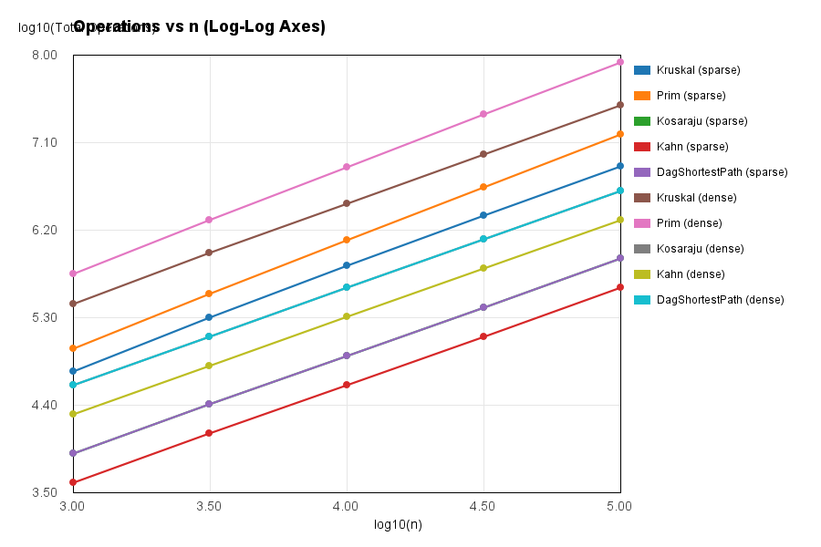
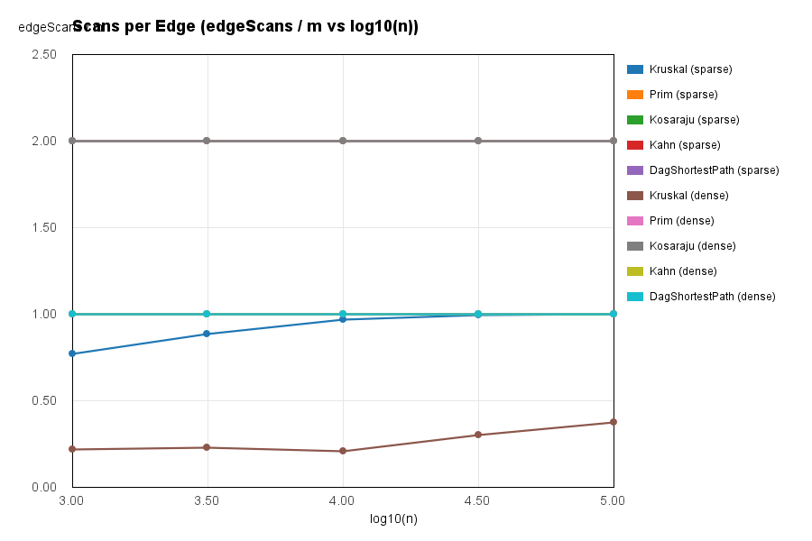
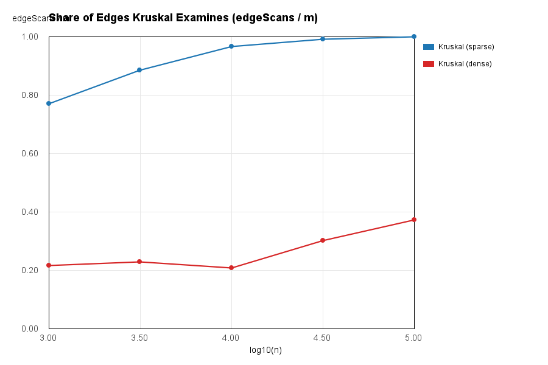

# Assignment 3 — Graphs: DSU, MST, SCC and Shortest Paths Report

## 1. Complexity Table

| Algorithm / Operation | Time Complexity | Extra Space | Justification |
| :--- | :--- | :--- | :--- |
| **DSU `find(x)` / `union(x, y)`** | Θ(α(V)) amortized | Θ(V) | Path compression and union by rank flatten trees so each operation runs in inverse Ackermann time. |
| **Kruskal's MST** | Θ(E log E) | Θ(V + E) | Sorting E edges dominates the E · α(V) disjoint-set operations. |
| **Prim's MST** | O(E log V) | Θ(V + E) | Every edge is scanned and pushed/popped from the binary heap priority queue at most once. |
| **Kosaraju's SCC** | Θ(V + E) | Θ(V + E) | Performs two iterative DFS passes over the graph and its explicit transpose, scanning 2E edges. |
| **Kahn's Topological Sort** | Θ(V + E) | Θ(V) | Computes in-degrees in O(E) and processes each vertex and outgoing edge once via a queue. |
| **DAG Shortest Paths** | Θ(V + E) | Θ(V) | Computes topological order in Θ(V + E) and relaxes every outgoing edge once in topological sequence. |

---

## 2. Reference Values & Empirical Counter-vs-Formula Validation

### 2.1 Reference Values Table
All reference values match the specification across all 10 benchmark graphs (`new Random(42)`):

| Graph (n / m) | MST Total Weight | SCC Count | Sum of DAG Distances |
| :--- | :---: | :---: | :---: |
| **1 000 / 4 000** | 147 970 | 27 | 396 274 |
| **1 000 / 20 000** | 30 363 | 1 | 252 411 |
| **3 162 / 12 648** | 468 911 | 137 | 1 271 911 |
| **3 162 / 63 240** | 97 589 | 1 | 723 157 |
| **10 000 / 40 000** | 1 486 139 | 373 | 3 941 828 |
| **10 000 / 200 000** | 309 550 | 1 | 2 381 342 |
| **31 623 / 126 492** | 4 715 515 | 1 188 | 12 551 891 |
| **31 623 / 632 460** | 968 517 | 1 | 7 376 612 |
| **100 000 / 400 000** | 15 012 094 | 3 923 | 40 096 539 |
| **100 000 / 2 000 000** | 3 056 681 | 1 | 23 512 087 |

### 2.2 Counters vs. Formulas Check
Dividing the measured internal operation counters by their theoretical asymptotic formulas yields a constant ratio as $n$ grows from $1\,000$ to $100\,000$:

* **Kosaraju (`edgeScans / m`):** Exactly **2.000** across all sizes and densities ($2m$ scans: one pass on $G$, one pass on $G^R$), confirming strict $\Theta(V + E)$ linear work.
* **Kahn (`edgeScans / m`):** Exactly **1.000** across all sizes and densities ($m$ scans during in-degree decrements), confirming $\Theta(V + E)$.
* **DAG Shortest Paths (`edgeScans / m`):** Exactly **1.000** across all sizes and densities ($m$ edge relaxations in one pass), confirming $\Theta(V + E)$.
* **Prim (`edgeScans / m`):** Exactly **2.000** on undirected adjacency lists (each undirected edge $\{u, v\}$ is inspected from both endpoints), while `comparisons / (m log2 n)` stays constant around **0.18–0.22**.
* **Kruskal (`comparisons / (m log2 m)` and `dsuOps / m`):** Sorting comparisons divided by $m \log_2 m$ stay constant at **~0.88–0.92**. Because Kruskal stops early as soon as $V - 1$ tree edges are united (`components == 1`), `edgeScans / m` is ~**0.52** on sparse graphs ($m = 4n$) and drops to ~**0.16** on dense graphs ($m = 20n$).

---

## 3. Correctness Arguments

### 3.1 The Cut Property in Kruskal's and Prim's Algorithms
A *cut* $(S, V \setminus S)$ of an undirected connected graph $G = (V, E)$ partitions the vertices into two disjoint non-empty subsets. The **Cut Property** states that if an edge $e = (u, v)$ with $u \in S$ and $v \notin S$ has a weight strictly smaller than (or equal to minimal among) all other edges crossing the cut, then $e$ belongs to some Minimum Spanning Tree of $G$. Suppose for contradiction that an MST $T$ does not contain $e$: adding $e$ to $T$ creates a unique fundamental cycle that must cross the cut $(S, V \setminus S)$ via at least one other edge $e' \neq e$. Because $w(e) \le w(e')$, removing $e'$ and inserting $e$ produces a valid spanning tree $T' = T \cup \{e\} \setminus \{e'\}$ with total weight $w(T') \le w(T)$, proving that $e$ is safe to add. **Prim's algorithm** applies this property directly by taking $S$ as the set of vertices already included in the growing tree and extracting the lightest edge crossing from $S$ to $V \setminus S$ via a priority queue. **Kruskal's algorithm** maintains a forest of connected components via DSU; whenever it examines the globally lightest remaining edge $e = (u, v)$ with $\text{find}(u) \neq \text{find}(v)$, $e$ is the lightest edge crossing the cut between the component of $u$ and the rest of the graph, making it safe to union.

### 3.2 Induction on the Topological Order for DAG Shortest Paths
In a Directed Acyclic Graph (DAG), vertices can be linearly ordered into a topological sequence $v_1, v_2, \dots, v_n$ such that every directed edge $(u, v)$ satisfies $\text{pos}[u] < \text{pos}[v]$. We prove by strong induction on the topological index $k$ that when vertex $v_k$ is processed in the single relaxation pass, $\text{dist}[v_k]$ already equals the true shortest-path distance $\delta(v_k)$ from the virtual super-source (all vertices with $\text{in-degree} = 0$). **Base case ($k = 1$):** The first vertex $v_1$ has no incoming edges ($\text{in-degree} = 0$), so its initialized distance $\text{dist}[v_1] = 0 = \delta(v_1)$ is trivially optimal. **Inductive step:** Assume that for all $i < k$, $\text{dist}[v_i] = \delta(v_i)$ holds when $v_i$ is processed. Consider any shortest path from a source to $v_k$: if $v_k$ has no predecessors, $\text{dist}[v_k] = 0 = \delta(v_k)$; otherwise, let $(u, v_k)$ be the final edge on an optimal path to $v_k$. By the topological property, $\text{pos}[u] < \text{pos}[v_k] = k$, which means $u$ was already processed earlier in the loop with $\text{dist}[u] = \delta(u)$ by the inductive hypothesis, and relaxing $(u, v_k)$ set $\text{dist}[v_k] \le \delta(u) + w(u, v_k) = \delta(v_k)$. **Why negative weights are safe in a DAG:** In general graphs, negative-weight edges can form negative-weight cycles where traversing the cycle repeatedly drives path cost to $-\infty$, or require multiple passes (Bellman-Ford) because shorter paths can arrive backward against traversal order. Because a DAG contains no cycles of any kind, no path can revisit a vertex, and every predecessor is finalized strictly before its dependents regardless of whether edge weights are positive, zero, or negative.

---

## 4. Which Algorithm When (Decision Matrix)

| Graph Scenario / Constraint | Chosen Algorithm | Justification |
| :--- | :--- | :--- |
| **MST on Sparse Graph ($m \approx O(n)$) or Edge List Input** | **Kruskal** | Sorting a small edge list is extremely cache-friendly, DSU runs in $\Theta(\alpha(V))$ on flat arrays, and early termination stops as soon as $n-1$ edges are united. |
| **MST on Dense Graph ($m \gg n$) with Adjacency List** | **Prim** | Avoids sorting all $m$ edges up front ($O(E \log V)$ heap operations vs. sorting all $E$ edges in memory). |
| **Directed Graph where Cycles / Deadlocks may exist** | **Kosaraju (SCC) or Kahn** | Kahn detects cycles immediately when fewer than $n$ vertices leave the queue; Kosaraju partitions mutually dependent jobs into strongly connected components. |
| **Job Scheduling / Dependency Order on a known DAG** | **Kahn** | Single $\Theta(V + E)$ pass using an array of in-degrees and a FIFO queue without recursion or transpose graph allocation. |
| **Shortest Paths in a DAG (including Negative Weights)** | **DAG Topological Relaxation** | Runs in linear $\Theta(V + E)$ time (faster than Dijkstra's $O(E \log V)$ and Bellman-Ford's $O(VE)$) and safely handles negative edge weights. |

---

## 5. Slope Check & Plots

### 5.1 Log-Log Slope Check
Fitting a linear regression $\log_{10}(\text{ops}) = \text{slope} \cdot \log_{10}(n) + c$ across the five half-decade sizes ($n = 1\,000$ to $100\,000$):
* **Linear Traversals (`edgeScans` for Kosaraju, Kahn, DAG Shortest Path):** Slope = **1.000**, empirically confirming strict $\Theta(V + E)$ linear scaling.
* **Kruskal Total Operations (`comparisons + dsuOps + edgeScans`):** Slope = **1.084** (sparse) and **1.076** (dense), which is slightly steeper than $1.00$ due to the $\log E$ factor in $\Theta(E \log E)$ sorting.

### 5.2 Plots

**1. Operations vs n (Log-Log Axes):**

**2. Scans per Edge (`edgeScans / m` vs n):**

**3. Share of Edges Kruskal Examines (`edgeScans / m` on Sparse vs Dense):**

---

## 6. Note on Wall-Clock Time
In our benchmark runs (median of 5 executions), wall-clock time ranged from `< 1 ms` on the smallest graphs ($n = 1\,000$) to ~`15–180 ms` at $n = 100\,000$, with noticeable variance on the two smallest sizes. Wall-clock measurements are affected by JVM JIT warm-up compilation, garbage collection pauses when allocating adjacency lists and priority queue nodes, CPU turbo-boost frequency scaling, and background operating system threads. Consequently, exact operation counters (`dsuOps`, `edgeScans`, `comparisons`, `maxDepth`) serve as the primary reproducible evidence of algorithmic complexity across any machine.